# Elementos gráficos Gov Hub (formas isoladas)

Os elementos de apoio da marca são formas geométricas simples, sempre
**sólidas** e na paleta sóbria (`palette.md`): círculo, anel, semicírculo,
quarto de círculo, pílula e suas derivadas (semi-pílula, meio-anel, quarto
de anel). Nunca ilustração figurativa, gradiente ou forma translúcida.

Não há templates de fundo prontos: os templates de slide coloridos do MIV
foram descontinuados em 2026-09-30. Monte a peça com os snippets abaixo:
slides em `slides-sober.md`, posts em `social-posts.md` (58 templates
prontos), capa de PDF em `print-cover.md`, marca d'água em
`print-watermark.md`.

## Formas isoladas (snippets)

As formas de apoio da marca, derivadas de "círculos, semicírculos e
retângulos arredondados" do MIV, como primitivas SVG limpas. Todas usam `fill="currentColor"`: defina `color` no
CSS com uma cor da paleta. Proporções: anel com furo de ~49 % do raio; pílula
2,66:1; semi-pílula 1,97:1.

Círculo:

```svg
<svg class="gh-shape gh-shape--circulo" viewBox="0 0 100 100" aria-hidden="true"><circle cx="50" cy="50" r="50" fill="currentColor"/></svg>
```

Anel (donut):

```svg
<svg class="gh-shape gh-shape--anel" viewBox="0 0 100 100" aria-hidden="true"><path fill="currentColor" fill-rule="evenodd" d="M50 0a50 50 0 1 0 0 100a50 50 0 1 0 0-100zM50 25.6a24.4 24.4 0 1 1 0 48.8a24.4 24.4 0 1 1 0-48.8z"/></svg>
```

Semicírculo (lado reto em cima, para sangrar pela borda superior):

```svg
<svg class="gh-shape gh-shape--semicirculo" viewBox="0 0 100 50" aria-hidden="true"><path fill="currentColor" d="M0 0h100a50 50 0 0 1-100 0z"/></svg>
```

Quarto de círculo (canto reto no canto superior esquerdo):

```svg
<svg class="gh-shape gh-shape--quarto" viewBox="0 0 100 100" aria-hidden="true"><path fill="currentColor" d="M0 0h100a100 100 0 0 1-100 100z"/></svg>
```

Pílula:

```svg
<svg class="gh-shape gh-shape--pilula" viewBox="0 0 266 100" aria-hidden="true"><rect width="266" height="100" rx="50" fill="currentColor"/></svg>
```

Semi-pílula (lado reto à direita, para sangrar pela borda):

```svg
<svg class="gh-shape gh-shape--semipilula" viewBox="0 0 197 100" aria-hidden="true"><path fill="currentColor" d="M197 0H50a50 50 0 0 0 0 100h147z"/></svg>
```

Meio-anel (lado reto em cima):

```svg
<svg class="gh-shape gh-shape--meioanel" viewBox="0 0 100 50" aria-hidden="true"><path fill="currentColor" fill-rule="evenodd" d="M0 0h100a50 50 0 0 1-100 0zM25.6 0h48.8a24.4 24.4 0 0 1-48.8 0z"/></svg>
```

Quarto de anel (canto reto no canto superior esquerdo):

```svg
<svg class="gh-shape gh-shape--quartoanel" viewBox="0 0 100 100" aria-hidden="true"><path fill="currentColor" fill-rule="evenodd" d="M0 0h100a100 100 0 0 1-100 100zM0 0h48.7a48.7 48.7 0 0 1-48.7 48.7z"/></svg>
```

Para virar a forma (sangrar por outra borda), use `transform: rotate(90deg)`
/ `180deg` / `270deg` ou `scaleX(-1)` no CSS. Só múltiplos de 90°.

```css
.gh-shape { display: block; }
.gh-shape--sangra-direita { position: absolute; right: -12%; bottom: -12%; width: 48%; color: var(--primary-purple); }
```

## Comunicação: Instagram, poster, banner

Post de feed parte dos templates prontos de `social-posts.md`. Para
outras peças (stories, poster, banner), componha com as formas isoladas
acima.

Formatos canônicos:

| Peça | Canvas |
|---|---|
| Feed quadrado | 1080×1080 px |
| Feed retrato | 1080×1350 px |
| Stories / Reels capa | 1080×1920 px |
| Poster A4 retrato | 210×297 mm (2480×3508 px a 300 dpi) |
| Poster A3 retrato | 297×420 mm (3508×4961 px a 300 dpi) |
| Banner web | 1920×600 px |

Regras de composição:

1. Fundo sólido em **navy**, **roxo** ou **claro** (branco ou `#F2F1F6`). Nunca gradiente.
2. De **2 a 4 formas**, sempre sangrando por pelo menos uma borda (nenhuma forma "flutuando" inteira no meio, exceto o anel pequeno como pontuação).
3. Forma principal com **40 a 50 % do lado menor** do canvas; as demais entre 15 e 30 %.
4. Cores só da paleta sóbria, cada forma numa cor diferente do fundo: sobre navy, roxo ou `#F2F1F6`; sobre roxo, navy ou `#F2F1F6`; sobre claro, roxo e navy. `#BE006E` no máximo num detalhe pequeno, e nunca sobre roxo. Sem círculo "tonal" translúcido.
5. Texto na zona livre, oposta às formas. Chamada em **Reddit Sans 800** (ou 400 misturado a 800), caixa alta e baixa; apoio em Reddit Sans 400. Sobre navy/roxo, texto branco; sobre claro, navy.
6. Logo Gov Hub na zona livre, respeitando a área de não-interferência (`SKILL.md`). Nunca sobre uma forma da mesma cor.
7. Rotação de formas só em múltiplos de 90°. Sem sombra, sem contorno, sem 3D.

Exemplo de feed quadrado (1080×1080):

```html
<div class="gh-post" style="position:relative;width:1080px;height:1080px;overflow:hidden;background:#0A005A;color:#fff;font-family:'Reddit Sans',sans-serif">
  <svg class="gh-shape" viewBox="0 0 100 100" style="position:absolute;right:-10%;top:-10%;width:48%;color:#613EFF;transform:rotate(90deg)"><path fill="currentColor" d="M0 0h100a100 100 0 0 1-100 100z"/></svg>
  <svg class="gh-shape" viewBox="0 0 100 50" style="position:absolute;left:8%;bottom:0;width:26%;color:#F2F1F6;transform:rotate(180deg)"><path fill="currentColor" fill-rule="evenodd" d="M0 0h100a50 50 0 0 1-100 0zM25.6 0h48.8a24.4 24.4 0 0 1-48.8 0z"/></svg>
  <div style="position:absolute;left:80px;top:120px;width:600px">
    <h1 style="font:800 84px/1.06 'Reddit Sans',sans-serif;letter-spacing:-0.025em;margin:0 0 24px">Chamada da arte</h1>
    <p style="font-size:30px;line-height:1.4;margin:0;opacity:.92">Texto de apoio curto, uma ou duas linhas.</p>
  </div>
  
</div>
```

## Regras de uso (valem para todas as formas)

- Só cores da paleta sóbria, sólidas; sem sombra, contorno, 3D ou gradiente.
- Rotação só em múltiplos de 90°; não distorça a proporção.
- Texto sempre na zona livre, nunca sobre uma forma de cor próxima à do texto.
- Em documentos (PDF/e-book), as formas entram na capa (`print-cover.md`) e, opcionalmente, como marca d'água (`print-watermark.md`).

## Como adicionar uma forma nova

Acrescente o snippet SVG na seção "Formas isoladas", com `fill="currentColor"`
e proporção derivada das formas-base, e registre aqui em que peça ela foi
validada.
